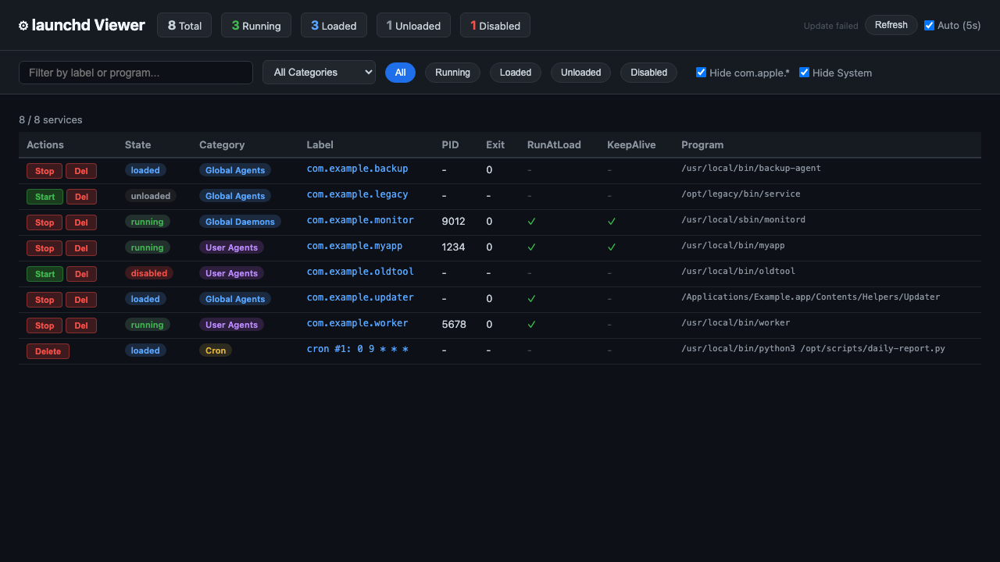

# launchd Viewer

A browser-based tool to visualize and manage macOS launchd services and cron jobs.



## Usage

```bash
python3 launchd_viewer.py
```

Opens automatically in your browser at http://127.0.0.1:8745

To stop/delete services under `/Library/LaunchDaemons/`, run with sudo:

```bash
sudo python3 launchd_viewer.py
```

## Features

- **Overview** — View User Agents, Global Agents, Global Daemons, System services, and Cron jobs in one place
- **Status badges** — Color-coded Running / Loaded / Unloaded / Disabled states
- **Filtering** — Filter by category, status, or text search (label and program path)
- **Hide system services** — com.apple.* and System services hidden by default
- **Column sorting** — Click headers to sort
- **Detail view** — Click a row to expand plist path, KeepAlive conditions, StartInterval, etc.
- **Stop / Start** — Stop or start services via launchctl unload/load
- **Delete** — Remove plist files (stops the service first)
- **Cron management** — Delete cron entries
- **Live updates** — Auto-refreshes every 5 seconds (toggleable), with manual refresh button

## Requirements

- macOS
- Python 3 (standard library only, no additional packages)
